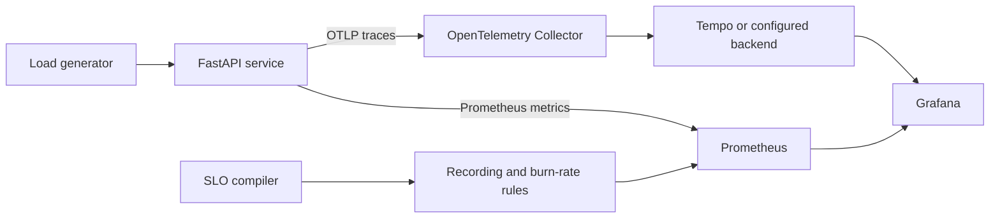

# SRE Observatory

SRE Observatory is a compact internal-platform reference repository: an instrumented service,
reliability objectives, deployment safety controls, infrastructure modules, and an incident drill
that can be reviewed together.

This repository is an implementation and validation artifact. It does **not** claim that the AWS
or Kubernetes resources have been deployed, nor does it claim production traffic or cloud scale.

## System Shape



The service exposes `/work`, `/healthz`, `/readyz`, and `/metrics`. Request metrics use normalized
route labels, traces are exported over OTLP/HTTP, and the controlled `FAIL_EVERY_N` setting supports
repeatable failure exercises without a hidden administrative endpoint.

## Reliability Contract

| SLO | Objective | Indicator |
| --- | ---: | --- |
| Availability | 99.9% over 30 days | Non-5xx responses, excluding probes and metrics |
| Latency | 99% under 300 ms over 30 days | Prometheus request-duration histogram |

The dependency-free compiler reads [`slo/service.json`](slo/service.json) and produces
[`observability/prometheus/slo-rules.yaml`](observability/prometheus/slo-rules.yaml). It emits
14 deduplicated recording rules and eight alerts using 1h/5m, 6h/30m, 1d/2h, and 3d/6h
multi-window burn-rate pairs.

## Run Locally

Full stack prerequisites are Docker with Compose:

```bash
docker compose up --build
python tools/loadgen.py --url http://localhost:8080/work --rps 10 --duration 30
```

- Service: `http://localhost:8080/healthz`
- Prometheus: `http://localhost:9090`
- Grafana: `http://localhost:3000` (anonymous viewer for local use)

Docker, Terraform, and kubectl were unavailable in the authoring environment. Their configurations
are validated in CI with Docker BuildKit, Hadolint, Terraform, kubeconform, promtool, yamllint, and
ShellCheck.

The dependency-free checks available with Python 3.11+ are:

```bash
PYTHONPATH=service python -m unittest discover -s tests -v
python scripts/render_slo_rules.py --check
python scripts/validate_configs.py
python -m compileall -q service sre_tools scripts tools tests
```

PowerShell uses `$env:PYTHONPATH='service'` before the unittest command.
[`constraints.txt`](constraints.txt) pins the dependency resolution exercised by local tests and CI;
runtime installs consume the same constraints without installing development-only packages.

## Deployment

[`deploy/kubernetes`](deploy/kubernetes) contains a Kustomize base with:

- startup, liveness, and readiness probes;
- non-root, read-only containers with resource requests and limits;
- rolling updates, HPA, PDB, topology spreading, and NetworkPolicy;
- an OTLP collector that exports to debug logs until a durable backend is configured.

Deploy an immutable image and run the smoke check:

```bash
IMAGE=registry.example/sre-observatory:git-sha ./scripts/deploy.sh
./scripts/rollback.sh                         # previous revision
REVISION=3 ./scripts/rollback.sh              # selected revision
```

Terraform modules under [`infra/terraform/modules`](infra/terraform/modules) define a VPC and a
private-endpoint EKS cluster. See [`docs/operations.md`](docs/operations.md) before planning or
applying infrastructure.

## Incident Exercise

The opt-in drill makes every second `/work` request fail, drives exactly 3,600 requests, verifies a
45-55% 503 ratio, captures JSON evidence under ignored `artifacts/`, and always restores the
Deployment:

```bash
CONFIRM_CHAOS=sre-observatory ./scripts/chaos-drill.sh
```

Procedure and expected signals are in
[`docs/incidents/deterministic-failure-drill.md`](docs/incidents/deterministic-failure-drill.md);
response guidance is in
[`docs/runbooks/high-error-budget-burn.md`](docs/runbooks/high-error-budget-burn.md).

## Repository Map

| Path | Responsibility |
| --- | --- |
| `service/observatory/` | API, health state, metrics, and tracing |
| `sre_tools/slo.py` | SLO math and deterministic rule generation |
| `observability/` | Prometheus, OpenTelemetry, Tempo, and Grafana provisioning |
| `deploy/kubernetes/` | Workload and runtime safety controls |
| `infra/terraform/` | Reusable network and EKS modules plus a dev composition |
| `scripts/` | Validation, deployment, rollback, and incident drill automation |
| `tests/` | SLO math, configuration, load-generation, and service tests |

## Resume Evidence

- Built a Python service with low-cardinality Prometheus RED metrics, OTLP traces, health/readiness
  probes, and provisioned Prometheus, Tempo, and Grafana configuration
  ([service](service/observatory/main.py), [dashboard](observability/grafana/dashboards/service-overview.json)).
- Codified 99.9% availability and 99%-under-300-ms latency objectives as generated multi-window
  burn-rate alerts, with executable tests for budget math and rule generation
  ([definition](slo/service.json), [tests](tests/test_slo.py)).
- Implemented reviewable Kubernetes and Terraform platform controls plus verified rollout,
  rollback, load, and deterministic incident automation
  ([Kubernetes](deploy/kubernetes), [Terraform](infra/terraform), [drill](scripts/chaos-drill.sh)).

## Known Boundaries

- Kubernetes metrics-server and a Prometheus installation are cluster prerequisites.
- The bundled Kubernetes collector logs traces; configure a durable exporter before production use.
- The development Terraform composition uses one NAT gateway by default to control cost, accepting
  reduced AZ resilience. It creates billable AWS resources if applied.
- Container tags are explicit but a production promotion process should resolve them to digests and
  attach an SBOM/signature.

Licensed under Apache-2.0. See [`LICENSE`](LICENSE).
